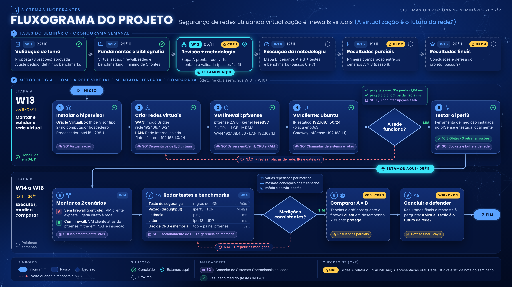

# INF0336 - Seminário

## Segurança de Redes utilizando Virtualização e Firewalls virtuais (A virtualização é o futuro das redes?)

## Equipe:
202500848 - GABRIEL APPLETON SALLES FLEURY

202401786 - HELLEN KASSIA DOS REIS COSTA

202501054 - JOÃO FREDERICO XAVIER GUIMARÃES RIBEIRO

202401793 - JOAO VITOR CARDIM RODRIGUES

## Apresentações
1. [Checkpoint 1](https://canva.link/73rfhcrhd8khglb)  
2. [Checkpoint 2](https://canva.link/xav05632zgdrol2)  
3. Link para a terceira apresentação (canva, google slides, etc.)  

## Resumo
- Introdução: O Seminário consiste no desenvolvimento de uma simulação virtual de uma rede de computadores. Faremos a comparação do benchmarking de duas máquinas virtuais e suas respostas a ataques de segurança: uma apresentando firewall virtual e outra sem proteção.
- Métodos: O software VirtualBox (Oracle) será o ambiente de laboratório onde as máquinas funcionarão. Por sua vez, o software pfSense será utilizado para a introduão do firewall virtual. Por fim, a comparação de benchmarking será provida pelos dados colhidos no próprio pfSense. 
- Resultados Esperados: É esperado que a máquina virtual que rode com a proteção de um firewall virtual tenha uma performance pior do que aquela sem a proteção. Nosse enfoque é analizar a proximidade entre esses dois casos de uso.
- Conclusão (1 oração)

## Introdução

- **Motivação:** Dois membros do projeto já apresentavam interesse pelo tema de virtualização: Hellen trabalha na área de segurança de redes de computadores e queria introduzir a utilização de firewalls virtuais; João Vítor faz parte de um projeto de virtualização e offloading de processos. Assim sendo, unindo o útil ao agradável, seguimos a ideia de Hellen de trabalharmos com segurança de redes utilizando virtualização.  
Nesse sentido, trabalharemos com os temas de **Virtualização** e **Segurança de Redes**, de modo a utilizar conceitos apresentados durante a disciplina, como por exemplo o de kernell e system calls.
- **Revisão bibliográfica:** Pesquise o tema utilizando, pelo menos, cinco fontes (as mesmas que devem ser úteis para a seção de Discussão). Utilize literatura confiável, por exemplo, Google Acadêmico ou publicações revisadas por pares (blogs, repositorios, publicações online, etc.).
- **Revisão bibliográfica:** 
"A Comprehensive Study on Virtualization Techniques and Their Role in Cloud Computing" [1] introduz o conceito de hypervisor (utilizado pela VirtualBox) e sua importância para computação em redes.
  É imperativo incluir também a documentação dos softwares opensource utilizados VirtualBox e pfSense.
- **Objetivos:** Entender e aplicar os conceitos de **Virtualização** em **Seguraça de Redes** de modo a simular uma rede de computadores virtuais e realizar o benchamarking de uma máquina virtual funcionando com e sem firewalls virtuais.

## Metodologia
- **Conjunto de dados (*Dataset*):** O conjunto de dados que serão utilizados em nossa análise será coletado por meio dos relatórios do pfSense sobre as nossas máquinas virtuais.  
Os experimentos realizados serão um teste de segurança básico do funcionamento do firewall virtual, bem como de execuções de tarefas que verifiquem os fatores quantitativos abaixo colocados.
- **Modelos:** O conjunto de tecnologias que utilzaremos serão os softwares open source mencionados anteriormente: VirtualBox e pfSense. Essas tecnologias também serão utilizadas para estabelecer nossa infraestrutura simulada.
- **Métricas:** No quesito **qualitativo**, consideramos o objetivo do projeto alcançado caso uma rede de (no mínimo) 2 computadores virtuais em que ao menos um dos computadores esteja protegido por um firewall virtual seja efetivamente implementada. Isso nos garante um laboratório coerente à realização dos experimentos e valida a qualidade dos dados coletados.  
No que tange o **quantitativo**, verificaremos a vazão de internet (*network throughput*) por meio da análise dos bps (bytes por segundo) de upload/download; verificaremos os parâmetros de latência e resposta (*latency and jitter*) por meio da análise das execuções em ms (milissegundos) e verificaremos os recursos do sistema e sobrecarga (*system resources overhead*) por meio da porcentagem de consumo de CPU e memória RAM.  
Sempre comparando com a máquina controle (àquela que não apresenta a proteção do firewall).
- **Fluxograma:**

## Resultados
- Gráficos
- Tabelas
- Multimídia (vídeos, imagens, áudio)

## Discussão
Análise com base na literatura utilizada na Introdução.

## Conclusão
Em que medida os objetivos foram alcançados?

## Referências
[1] SILBERSCHATZ, Abraham; GALVIN, Peter Baer; GAGNE, Greg. **Fundamentos de sistemas operacionais**. 8. ed. Rio de Janeiro: LTC, 2010.  
[2] MIERZWA, Stanley J.; ENG, Christopher. Utilizing a Virtual Firewall Appliance for Introducing and Reinforcing the Concepts and Implementation of Devices to Improve Security in a Computing Environment. Cybersecurity Pedagogy and Practice Journal, v. 4, n. 2, p. 51–66, 2025. Disponível em: https://digitalcommons.kean.edu/cybersecurity/49/. Acesso em: 4 nov. 2026.  
[3] ALMOUDANE, Mohamed. A Comprehensive Study on Virtualization Techniques and Their Role in Cloud Computing. 2025. Preprint, ResearchGate. Disponível em: https://www.researchgate.net/publication/391768446_A_Comprehensive_Study_on_Virtualization_Techniques_and_Their_Role_in_Cloud_Computing. Acesso em: 2 nov. 2026.  
[4] SUETOR, Cyril Godwin et al. An Overview of Distributed Firewalls and Controllers Intended for Mobile Cloud Computing. Applied Sciences, v. 15, n. 4, p. 1931, 2025. Disponível em: https://www.mdpi.com/2076-3417/15/4/1931. Acesso em: 2 nov. 2026.  
[5] KOPEĆ-PERSIŃSKI, Bartosz; BĘBEN, Andrzej. Virtual Firewalls Scaling and Placement with Traffic Distribution in Telco Cloud-Edge Continuum. Journal of Network and Systems Management, v. 34, n. 4, p. 121, 2026. Disponível em: https://link.springer.com/article/10.1007/s10922-026-10105-x. Acesso em: 4 nov. 2026. 
[6] RAJESH, K.; VETRIVELAN, P. Comprehensive analysis on 5G and 6G wireless network security and privacy. Telecommunication Systems, v. 88, n. 2, p. 1–29, 2025. Disponível em: https://link.springer.com/article/10.1007/s11235-025-01282-2. Acesso em: 4 nov. 2026.
[7] ORACLE. Oracle VirtualBox: user guide for release 7.1. Disponível em: https://docs.oracle.com/en/virtualization/virtualbox/7.1/user/index.html. Acesso em: 1 nov. 2026.  
[8] NETGATE. pfSense documentation. Disponível em: https://docs.netgate.com/pfsense/en/latest/. Acesso em: 1 nov. 2026.  
